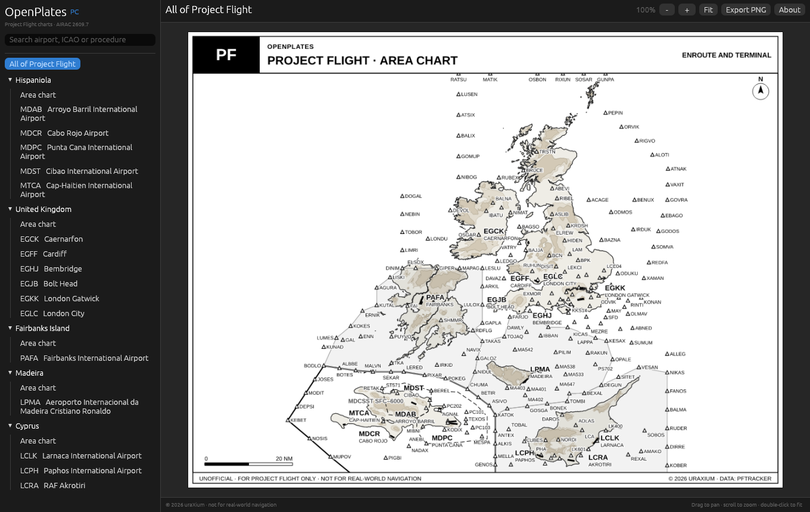
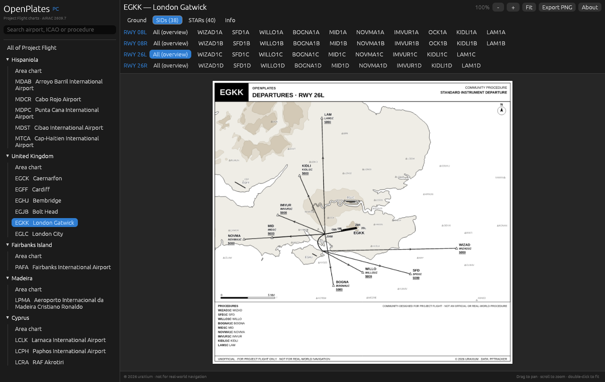
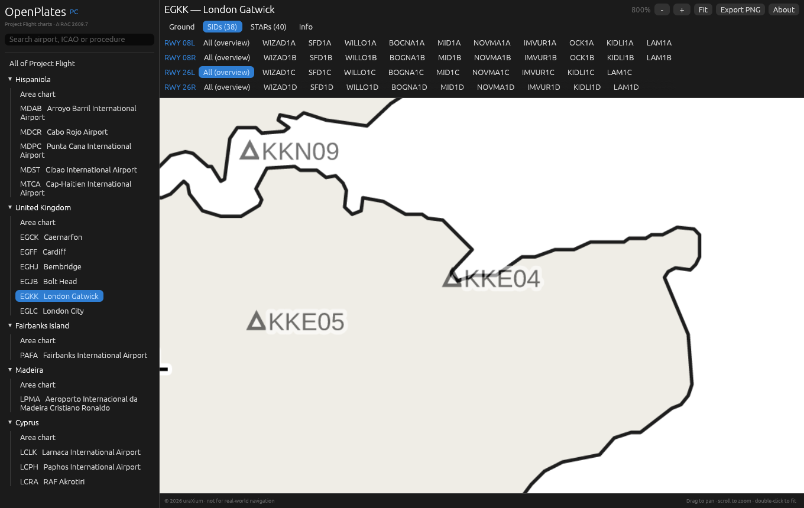
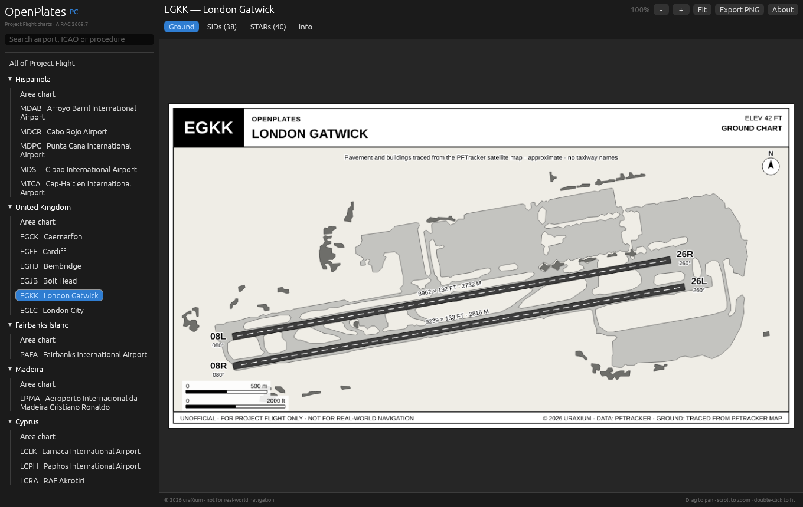
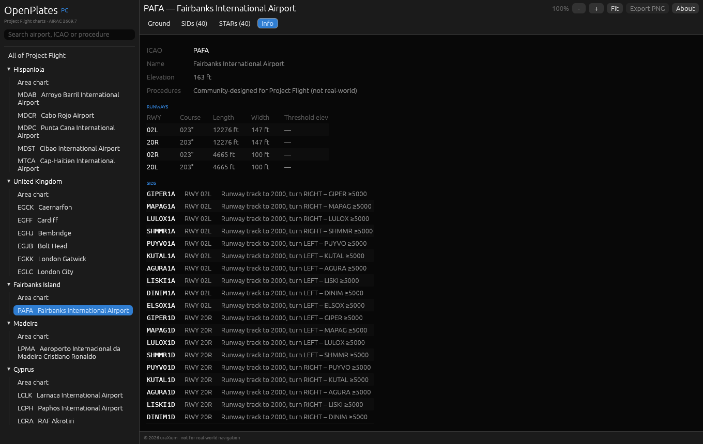

# OpenPlates

**Real-world-style aviation charts for [Project Flight](https://www.roblox.com/) (Roblox), in a fast desktop app.**

Area charts, ground charts, SIDs and STARs for every Project Flight airport, drawn the way real charts look: black-and-white islands and terrain, real runway placement, PFTracker waypoints.



> ⚠️ Unofficial. Not affiliated with Project Flight or Roblox. For simulation only: **never use these charts for real-world navigation.**

---

## Download

1. Go to **[Releases](https://github.com/dev-uraXium/openplates/releases/latest)**.
2. Download `OpenPlates.exe`.
3. Double-click it. Nothing to install.

Windows may show a blue *"Windows protected your PC"* box the first time, because the app isn't code-signed. Click **More info → Run anyway**.

Requirements: Windows 10 or 11 (64-bit) with OpenGL 2.0+ (any GPU from the last ~12 years).

## What's inside

| | |
|---|---|
| **5 regions** | Hispaniola, United Kingdom, Fairbanks Island, Madeira, Cyprus, plus a chart of the whole map |
| **16 airports** | Ground chart, SIDs, STARs and an info page for each |
| **850 SID & STAR charts** | Grouped by runway, with an "All" overview chart per runway |
| **872 charts** in total | All built into the app, no internet needed |

## How to use

### Finding a chart
- **Sidebar:** pick a region's **Area chart**, or click an airport.
- **Search:** type an ICAO (`EGKK`), a name (`Gatwick`) or a procedure (`WIZAD`). Procedure results open straight to that chart.

### Airport tabs
| Tab | Shows |
|---|---|
| **Ground** | Runways, taxiways, aprons and buildings |
| **SIDs** | Departures. Pick a runway row, then a procedure, or **All (overview)** to see every SID from that runway |
| **STARs** | Arrivals, same layout as SIDs |
| **Info** | Elevation, frequencies, runway table (course, length, width) and every procedure's route in text |



### Moving around a chart
| Action | How |
|---|---|
| Zoom | Mouse wheel / trackpad pinch, or the **+** / **-** buttons |
| Pan | Click and drag |
| Fit to window | Double-click, or **Fit** |

Charts redraw sharper as you zoom in (up to 800%).



### Exporting
**Export PNG** saves the chart you're looking at as a high-resolution image (3×), ready to print or put on a second screen.
You may share exported images as-is; you may not edit them or pass them off as your own (see [License](#license)).

## Screenshots

| Ground chart | Airport info |
|---|---|
|  |  |

---

## Building from source

The app is written in Rust with [egui](https://github.com/emilk/egui) (UI) and [resvg](https://github.com/linebender/resvg) (chart rendering).

```bash
# Windows, macOS or Linux, native build
cargo build --release

# Windows .exe from Linux (needs mingw-w64 and the x86_64-pc-windows-gnu target)
rustup target add x86_64-pc-windows-gnu
cargo build --release --target x86_64-pc-windows-gnu
```

### About the chart bundle

The chart data is **not** in this repository. The official release embeds an encrypted bundle (`private/charts.bin` + `private/key.rs`) that is kept private.

If you build from a fresh clone, `build.rs` notices that `private/` is missing, builds the app anyway, and the app tells you it has no charts. To build with charts you need your own bundle:

1. Put one SVG per chart, plus an `_index.json` describing them, in `export/`.
2. Run `python3 pack.py` (needs `cryptography`). It writes `private/charts.bin` and a fresh random `private/key.rs`.
3. `cargo build --release`.

Each chart is zlib-compressed and ChaCha20-encrypted with its own nonce, and is decrypted only in memory when opened. This keeps casual users from pulling the data out of the .exe; it is not DRM and won't stop a determined reverse-engineer.

### Project layout

```
src/main.rs     UI: sidebar, tabs, procedure chips, chart viewer, info page, about box
src/render.rs   background thread: decrypt → parse SVG → rasterise; PNG export
src/bundle.rs   reads the encrypted bundle compiled into the binary
build.rs        copies private/ into the build, or a placeholder if it's missing
pack.py         builds private/charts.bin + private/key.rs from export/
assets/         Liberation Sans fonts (SIL OFL 1.1)
docs/           landing page (GitHub Pages) and screenshots
```

## Contributing

Bug reports and pull requests for the app are welcome. Open an issue first for anything big.
Wrong chart? Open an issue with the airport, chart name and what's off (a screenshot helps).

## License

- **Source code** (everything in this repository except `assets/` fonts): [MIT](LICENSE).
- **Charts** (the chart bundle shipped in the official release, and images exported from it): © 2026 uraXium, all rights reserved. You may use them and share unmodified exports; modifying or redistributing them requires prior permission from uraXium.
- **Fonts:** Liberation Sans, [SIL Open Font License 1.1](assets/OFL.txt).
- **Data credits:** waypoints from PFTracker; some ground layouts © [OpenStreetMap](https://www.openstreetmap.org/copyright) contributors (ODbL 1.0).

Project Flight and Roblox are trademarks of their respective owners. OpenPlates is a fan project and is not endorsed by them.
